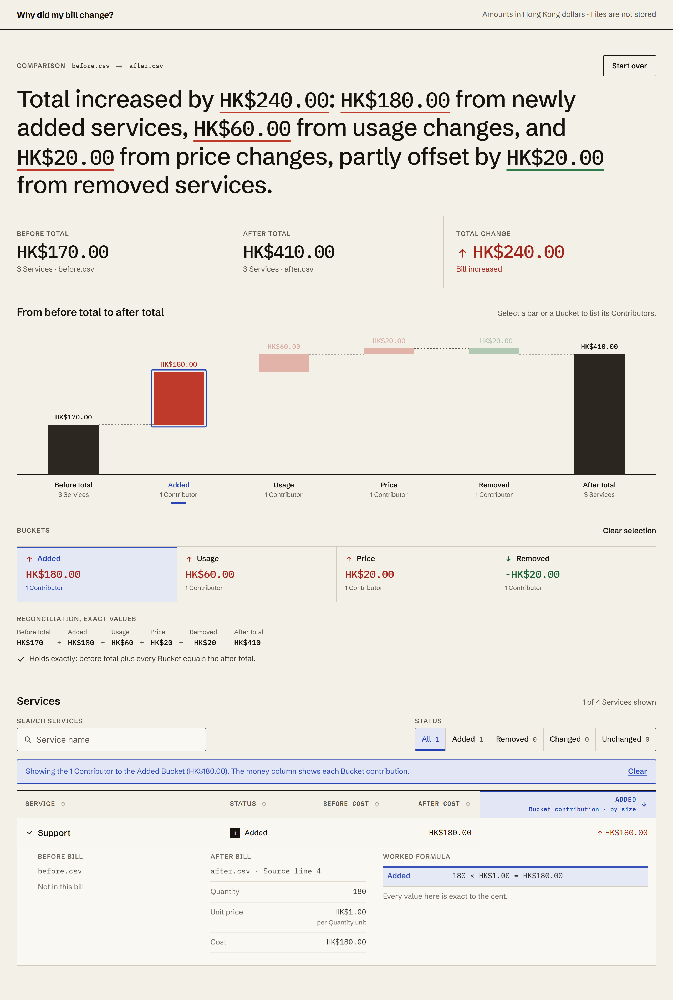
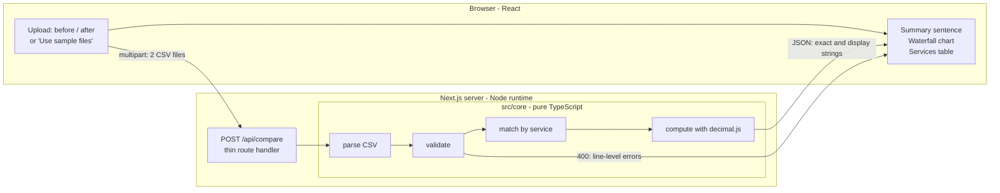

# Why did my bill change?

Compare two monthly bill CSV exports and see exactly where the Total change came
from: a waterfall that splits the difference into four Buckets (added, usage,
price, removed), and a Services table with the source line and worked formula
behind every row. Every amount reconciles to the cent.



## Run it

```bash
docker build -t why-my-bill-change .
docker run --rm -p 3000:3000 why-my-bill-change
```

Open http://localhost:3000 and choose **Use sample files**.

Or run it from source (Node 22):

```bash
npm install
npm run dev          # http://localhost:3000
npm run build && npm start
```

## Demonstration

After the container is running, open http://localhost:3000 and choose **Use
sample files**. Select the Added bucket, then expand Support to see its source
line and the HK$180 contribution.

The static visual reference is [prototype/index.html](prototype/index.html).
Open that file in a browser; it needs no install and no server.

The architecture diagram is
[docs/architecture/bill-change.architecture.html](docs/architecture/bill-change.architecture.html).
Open that file in a browser. The mermaid sketch under **How it works** is the
same flow in short form.

## Input format

UTF-8 CSV with the header `service,quantity,unit_price`, one row per Service:

```csv
service,quantity,unit_price
Compute,160,1
Storage,50,1.40
Support,180,1
```

- Header names are trimmed and case-insensitive. Extra columns are ignored;
  each required column must appear exactly once.
- `quantity` and `unit_price` are plain decimals with at most 12 digits on each
  side of the point. Values outside that range, duplicate Service names, empty
  fields, and malformed rows are rejected with the file, source line, and
  column.
- A Service name must match exactly across the two files. A header-only file is
  valid and means an empty bill.

## Assumptions

- **Currency is Hong Kong dollars.** There is no currency column and no
  conversion.
- **A matching Service name is the same billable item in the same Quantity
  unit** (for example hours, or gigabytes). The files have no unit column, so
  the app cannot check this; it is an input requirement.
- Uploads are read into memory, compared, and discarded when the response is
  sent. Nothing is written to a database or to browser storage, and the log
  line records only the outcome, status, row counts, duration, and error
  category.

## The formula

Let `q0, p0` be the before Quantity and unit price, and `q1, p1` the after
values. Cost is `quantity × unit_price`.

| Status | Total change |
|---|---|
| Added (before only: none) | `q1 × p1` |
| Removed (after only: none) | `−(q0 × p0)` |
| Changed | `q1 × p1 − q0 × p0` |
| Unchanged | `0` |

A changed Service is split sequentially, Usage at the old price and Price at the
new quantity, so the two effects add up to the Total change with no interaction
term left over:

```
Usage effect = (q1 − q0) × p0
Price effect = (p1 − p0) × q1
Total change = Usage effect + Price effect = q1 × p1 − q0 × p0
```

Buckets sum the same effects across Services, and the Reconciliation is the
identity `before total + added + usage + price + removed = after total`.

### Worked example

The headline pair in `samples/`:

| Service | Before | After | Usage effect | Price effect | Total change |
|---|---|---:|---:|---:|---:|
| Compute | 100 × HK$1.00 = HK$100.00 | 160 × HK$1.00 = HK$160.00 | HK$60.00 | HK$0.00 | HK$60.00 |
| Storage | 50 × HK$1.00 = HK$50.00 | 50 × HK$1.40 = HK$70.00 | HK$0.00 | HK$20.00 | HK$20.00 |
| Legacy | 20 × HK$1.00 = HK$20.00 | not billed | HK$0.00 | HK$0.00 | −HK$20.00 |
| Support | not billed | 180 × HK$1.00 = HK$180.00 | HK$0.00 | HK$0.00 | HK$180.00 |

Before total HK$170.00, after total HK$410.00, Total change HK$240.00, divided
into added HK$180.00, usage HK$60.00, price HK$20.00, and removed −HK$20.00.

Expanding Support shows its worked formula: `180 × HK$1.00 = HK$180.00`, with
`after.csv` and source line 4.

## How it works



- All parsing, validation, matching, and arithmetic live in `src/core/` as plain
  TypeScript: `parse`, `validate`, `compare`, `summary`, `money`, `present`.
- `POST /api/compare` is a thin adapter. `GET /samples/<file>` serves the seven
  sample CSVs from `samples/`. The four demos are Headline, Rounding, Invalid,
  and Opposing. Invalid reuses the headline `after.csv`.
- The browser never calculates or rounds money. The API sends each amount twice:
  an exact decimal string and a display string rounded to the cent, plus a notice
  when the rounded displays do not add up. Each bucket in the JSON also includes
  `from` and `to`: the running waterfall level before and after that step. Sorting
  and the waterfall's magnitude order compare exact strings (`src/lib/exact-order.ts`),
  never a `Number`.
- The chart is hand-built SVG. Converting amounts to pixel coordinates is the
  only place a float is used.
- `npm run check:core` fails the build if `Number(` or `parseFloat` appears in
  `src/core`, `src/lib/exact-order.ts`, or `src/lib/services-view.ts`.

## Scripts

| Command | Purpose |
|---|---|
| `npm run dev` | Development server |
| `npm run build` / `npm start` | Production build and Node server |
| `npm test` | Vitest: golden fixtures, property tests, validation, API, sort and summary units |
| `npm run e2e` | Playwright against a production build (builds, starts on port 3100, runs the headline and error flows, desktop and 390px) |
| `npm run lint` | ESLint with `eslint-config-next` |
| `npm run check:core` | Rejects floating-point money in the core and ordering modules |
| `npm run typecheck` | `tsc --noEmit` |

`node scripts/capture-screenshot.mjs` regenerates `docs/screenshot.png` from a
server on port 3100.

## Repository layout

| Path | Contents |
|---|---|
| `src/core/` | CSV parsing, validation, comparison, summary, money, JSON shape |
| `src/app/` | App Router page, `POST /api/compare`, sample CSV route |
| `src/components/` | Upload, headline, waterfall, Buckets, Services table, errors |
| `src/lib/` | Exact-decimal ordering, table view model, sample loaders |
| `tests/` | Vitest suites, golden fixtures, Playwright e2e |
| `samples/` | Four demo pairs: Headline, Rounding, Invalid, Opposing |
| `prototype/` | Static OpenDesign prototype, the visual reference |

[`docs/AI_WORKFLOW.md`](docs/AI_WORKFLOW.md) records how the work was directed
and verified, and which test caught each AI mistake.
