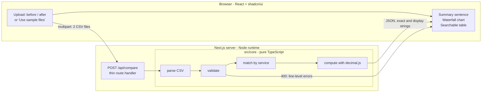

# "Why did my bill change?" explorer: Design

Date: 2026-10-31
Status: Reviewed. Static prototype built and reviewed on 2026-11-02 (section 8).

Domain terms are defined in `CONTEXT.md`. This document specifies the product and its acceptance checks.

## 1. Goal

Compare two monthly expense or cloud-cost CSV exports and explain the difference with a waterfall chart and a searchable table. The breakdown must reconcile exactly to the total change. Amounts are Hong Kong dollars.

Demo: upload the two sample files, select the added bucket, and expand Support to see the source line and calculation behind its HK$180.00 contribution.

A static prototype, generated in OpenDesign and reviewed in a browser, fixes the interface before the Next.js build starts (section 8).

The project is an interview work submission. It is judged on how well AI was directed and how the result was verified, so verification is a first-class part of the design. Budget: about 2 days at 4-6 hours per day. The review clarifications below fit that budget.

## 2. Decisions

| Topic | Decision |
|---|---|
| Stack | Next.js (App Router) + React + TypeScript, Node runtime |
| UI | Tailwind + shadcn/ui + a charting library (Recharts) |
| Prototype | Static HTML in `prototype/`, generated in OpenDesign. It is the visual and interaction reference; the shipped app is still Next.js with `src/core` behind the API |
| Arithmetic | decimal.js, configured for exact results on every accepted input |
| Currency | HKD only. No conversion and no currency field |
| Numeric limits | At most 12 integer digits and 12 fractional digits per quantity and unit price |
| Display | Each amount is rounded independently, half away from zero, to 2 decimals. A notice appears when those displayed amounts do not add up |
| Price/quantity split | Sequential: usage at old price, then price change at new quantity |
| Service identity | Exact match on the trimmed service name. Matching names are the same billable item and quantity unit by input contract |
| Duplicate services in a file | Rejected with line numbers |
| Bucket selection | Any bucket with contributors stays selectable, including a bucket whose contributions cancel to zero |
| Delivery | Single Docker image, one `docker run` command, run locally by the reviewer |
| State | Stateless: no database, no login, no retained uploads |

## 3. Architecture

One Next.js app. All parsing, validation, matching, arithmetic, display formatting, and summary text live in `src/core/`, which is plain TypeScript with no Next.js or React imports. The API route is a thin adapter. The browser renders the returned exact values and display strings. It does not calculate or round money.

The chart may convert exact amounts to floating-point coordinates for drawing. Sorting, filtering, summaries, reconciliation, and displayed money use the exact values and the server-provided display strings. A bucket contribution of `0.004` remains a contribution even when its display string is `HK$0.00`.



### Units

| Unit | Purpose | Depends on |
|---|---|---|
| `src/core/parse` | CSV text to raw rows with source lines | CSV parser library |
| `src/core/validate` | Raw rows to typed rows, or a list of errors | decimal.js |
| `src/core/compare` | Match two typed row sets and compute per-row and bucket effects | decimal.js |
| `src/core/summary` | Build the summary sentence and display strings | decimal.js, for display rounding only |
| `src/app/api/compare/route.ts` | HTTP adapter: read multipart, call core, map errors to 400 | core |
| `src/components/*` | Upload, headline, waterfall, table | API JSON only |

### Retention

The server reads each upload into memory, computes the comparison, and discards the file contents when the response is sent. Results live in the current page's React state. They are not written to browser storage, so a reload clears them. Application logs may include the outcome, status code, row counts, duration, and error category. They exclude file contents, filenames, service names, quantities, unit prices, and costs.

Starting a comparison hides the previous results and errors, then shows a loading state. Success shows the new comparison with search, status filter, bucket selection, and sort reset. Failure shows the new errors and no previous chart.

## 4. Input format

UTF-8 CSV with the header row `service,quantity,unit_price`. Both files contain HKD amounts. The app states that assumption and does not convert currency.

A matching service name means the same billable item measured in the same quantity unit. The file has no unit column, so the app cannot verify this. The README states it as an input requirement.

- Header names are trimmed and case-insensitive. Extra columns are ignored. After that normalization, each required header appears once. A repeated required header is a file-level error.
- A missing required header, a zero-byte file, a file with no header row, and a whitespace-only file are invalid. A header-only file is valid and means zero cost.
- `service`: non-empty after trimming. Matching between files is exact on the trimmed value and is case-sensitive.
- `quantity` and `unit_price`: plain non-negative decimals such as `120` or `0.0000166667`. No currency symbols, thousands separators, plus signs, or exponent notation. The integer part, ignoring leading zeros, has at most 12 digits. The fractional part has at most 12 digits. Larger values are validation errors.
- Each service appears at most once per file. A repeat is an error on the later source line.
- Limits per file: 1 MB and 10,000 data rows, not counting the header. A file over 1 MB is rejected before parsing.

Source lines are 1-based physical lines. A quoted field that contains a newline is one record, and its source line is the line where that record starts. The header is line 1 when it starts at the beginning of the file.

Validation collects recoverable errors across both files rather than stopping at the first bad cell. Each error has `file` (`before` or `after`), `line`, `column`, and `message`. File-level errors use `null` for `line` and `column`. Fatal errors—invalid encoding, a CSV structure that cannot be parsed, a missing or duplicate required header, an empty file, or a file over the size limit—produce one error for the affected file and stop further validation of that file. The other file is still validated. Row-count and cell errors apply only after a file parses. The API returns errors with status 400 as `{ errors: [...] }`. The repo includes a deliberately broken sample file to demonstrate this.

## 5. Calculation

Money uses decimal.js with an explicit precision of at least 80 significant digits and a rounding mode that does not change exact results inside the accepted limits. This covers a product of two 12.12-digit values and a sum of 10,000 such costs, including the usage and price intermediates. JSON carries exact values as strings, without exponent notation. If an intermediate ever needs more precision than configured, the reconciliation check fails and the API returns 500. It does not return a rounded financial result.

Display rounding is separate. Each exact amount is rounded independently, half away from zero, to 2 decimal places, and prefixed with `HK$`. This is decimal.js `ROUND_HALF_UP`. Rounded values are display strings only.

For each service, cost = quantity × unit_price. Let the before values be (q0, p0) and the after values be (q1, p1).

| Status | Condition | Total change | Usage effect | Price effect |
|---|---|---|---|---|
| added | only in after | q1 × p1 | 0 (the whole change counts in the `added` bucket) | 0 |
| removed | only in before | -(q0 × p0) | 0 | 0 |
| changed | in both, (q0, p0) differs from (q1, p1) | q1 × p1 − q0 × p0 | (q1 − q0) × p0 | (p1 − p0) × q1 |
| unchanged | in both, same values | 0 | 0 | 0 |

For changed services, usage effect + price effect = q1 × p1 − q0 × p0 exactly. Proof: (q1 − q0)p0 + (p1 − p0)q1 = q1p0 − q0p0 + p1q1 − p0q1 = p1q1 − q0p0.

A service with the same cost but different (q, p), for example 10 × 2 becoming 5 × 4, is changed, with a usage effect of −10 and a price effect of +10. It contributes to both buckets. Two opposing bars that net to zero is correct and informative.

A changed service can have a total change of zero and two zero effects. Quantity 0 at unit price 1 becoming quantity 0 at unit price 2 is changed, but it is not a contributor to either bucket.

A contributor is a service whose exact effect in that bucket is non-zero. Added services contribute to `added`. Removed services contribute to `removed`. A changed service contributes to `usage`, `price`, or both, according to its exact effects. Display rounding does not decide membership.

Waterfall buckets:

- `added` = sum of added-service costs
- `removed` = sum of removed-service costs (negative)
- `usage` = sum of usage effects over changed services
- `price` = sum of price effects over changed services

Invariant: before total + added + usage + price + removed = after total, exactly. The server asserts this and returns 500 if it is ever violated. That should be impossible, and the tests check it.

Worked example: EC2 goes from 100 × HK$0.10 to 120 × HK$0.12. Usage effect = 20 × 0.10 = HK$2.00. Price effect = 0.02 × 120 = HK$2.40. Total change = HK$4.40 = HK$14.40 − HK$10.00.

### Summary sentence

The server writes the summary sentence so that it is tested with the numbers. The sentence mentions only buckets whose exact total is non-zero. It says the bill increased, decreased, or did not change according to the exact total change.

A non-zero change that rounds to `HK$0.00` is not described as unchanged and is not described as `HK$0.00`. The sentence says it increased or decreased by less than HK$0.01. The exact value remains available in the response.

### Display notice

The response includes a display-rounding notice when independently rounded amounts do not add up in cents. The checked relationships are the displayed bucket amounts against the displayed total change, and the displayed waterfall steps from the displayed before total to the displayed after total. The notice is null when those displayed amounts agree. Exact values remain in the payload either way.

## 6. API

`POST /api/compare`, multipart form with file fields `before` and `after`.

Money fields are objects:

```json
{ "exact": "180", "display": "HK$180.00" }
```

Success (200):

```json
{
  "currency": "HKD",
  "totals": {
    "before": { "exact": "170", "display": "HK$170.00" },
    "after": { "exact": "410", "display": "HK$410.00" },
    "change": { "exact": "240", "display": "HK$240.00" }
  },
  "buckets": {
    "added": {
      "exact": "180",
      "display": "HK$180.00",
      "contributors": 1,
      "from": { "exact": "170", "display": "HK$170.00" },
      "to": { "exact": "350", "display": "HK$350.00" }
    },
    "usage": {
      "exact": "60",
      "display": "HK$60.00",
      "contributors": 1,
      "from": { "exact": "350", "display": "HK$350.00" },
      "to": { "exact": "410", "display": "HK$410.00" }
    },
    "price": {
      "exact": "20",
      "display": "HK$20.00",
      "contributors": 1,
      "from": { "exact": "410", "display": "HK$410.00" },
      "to": { "exact": "430", "display": "HK$430.00" }
    },
    "removed": {
      "exact": "-20",
      "display": "-HK$20.00",
      "contributors": 1,
      "from": { "exact": "430", "display": "HK$430.00" },
      "to": { "exact": "410", "display": "HK$410.00" }
    }
  },
  "summary": "Total increased by HK$240.00: HK$180.00 from newly added services, HK$60.00 from usage changes, and HK$20.00 from price changes, partly offset by HK$20.00 from removed services.",
  "displayRoundingNotice": null,
  "rows": [
    {
      "service": "Support",
      "status": "added",
      "buckets": ["added"],
      "before": null,
      "after": {
        "quantity": { "exact": "180", "display": "180" },
        "unitPrice": { "exact": "1", "display": "HK$1.00" },
        "cost": { "exact": "180", "display": "HK$180.00" }
      },
      "sources": {
        "before": null,
        "after": { "fileName": "after.csv", "line": 4 }
      },
      "usageEffect": { "exact": "0", "display": "HK$0.00" },
      "priceEffect": { "exact": "0", "display": "HK$0.00" },
      "change": { "exact": "180", "display": "HK$180.00" }
    }
  ]
}
```

`before` and `sources.before` are null for added rows. `after` and `sources.after` are null for removed rows. `buckets` lists only the buckets where the row's exact effect is non-zero. `contributors` counts those rows. Each bucket object also carries `from` and `to`: the running waterfall level before and after that bucket step (the before total plus preceding bucket totals, then plus this bucket). Quantity display strings keep their exact decimal text and have no currency prefix. A negative money display places the minus sign before `HK$`.

Errors: 400 `{ "errors": [{ "file", "line", "column", "message" }] }` for invalid input, including missing files and over-limit files. 500 if the reconciliation assertion fails.

## 7. UI

A single page built from shadcn/ui components. All money text, including the summary and notice, comes from the API response.

1. **Upload:** two file pickers (Before, After) and a "Use sample files" button. Submitting clears the previous comparison before the new result or errors appear.
2. **Headline:** the summary sentence, the display-rounding notice when present, and three stat cards (before total, after total, change).
3. **Waterfall chart:** before total, then added, usage, price, removed, then after total. Increases are red and decreases are green. Clicking a bucket bar selects that bucket. A labeled control for every bucket with `contributors > 0` shows the bucket name, its display total, and its contributor count. That control is how a zero-total bucket stays selectable. Selecting a bucket filters the table to its contributors. Selecting it again, or using a clear control, removes the filter.
4. **Table:** search by service name, filter by status, and sortable columns. With no bucket selected, the default sort is the largest total increase first. With a bucket selected, the table shows that bucket's contribution and defaults to the largest absolute contribution first. The user can change the sort. Ties break by service name, ascending. Sorting compares exact values with a decimal-safe comparison, not JavaScript `Number` conversion. A row expands to show each available source filename and source line, the parsed quantity, unit price, and cost, and the worked formula, for example `(120 − 100) × HK$0.10 = HK$2.00`.
5. **Errors:** validation errors are listed by file and line. File-level errors are listed against the file.

Exact values appear in tooltips and in the expanded row. Display strings appear in the chart labels, cards, table, and summary.

### Design direction

The look is an editorial ledger: a warm paper canvas (`#f3f0e8`) with ink-black type (`#17140f`), hairline rules doing the structural work instead of card shadows, and 2px corners. Headings are set in Schibsted Grotesk and every figure in IBM Plex Mono with tabular numerals. One deep cobalt accent (`#2341b5`) marks selection; red (`#bf3a2b`) and green (`#2d7a4b`) encode money direction only and are always paired with a sign or an arrow. The summary sentence is the largest type on the page. Motion is limited to state changes and respects `prefers-reduced-motion`.

Those values are the variables at the top of `prototype/styles.css`. The shadcn tokens are derived from them rather than chosen again.

The prototype in section 8 implements this list and settles the details it leaves open.

## 8. Prototype

A static prototype was generated in OpenDesign and reviewed in a browser on 2026-11-02. It is the visual and interaction reference for the Next.js app. It is not shipped and it does not replace `src/core` or its tests.

It lives in `prototype/` and opens by loading `prototype/index.html`. There is no build step, no server, and nothing to install.

| File | Role |
|---|---|
| `index.html` | the four states: upload, pending, result, error |
| `styles.css` | the design tokens and the "editorial ledger" look |
| `exact.js` | BigInt decimals, CSV parsing, the Comparison, the Reconciliation assertion, display rounding, the summary sentence |
| `demos.js` | the Headline, Rounding, Invalid and Opposing datasets as CSV text |
| `app.js` | the state machine, upload, the waterfall, Bucket selection, the table |

It implements section 5 unchanged: exact decimals with no floating point for money, the sequential usage-then-price split, the Reconciliation assertion, and independently rounded display strings. Its arithmetic is BigInt scaled integers rather than decimal.js: an input is held at 12 decimal places and a Cost, and everything derived from it, at 24, which covers a product of two 12.12-digit values without rounding. Parsing, validation and arithmetic run in the browser because the prototype has no server; the production app moves them into `src/core` behind `POST /api/compare`.

It was checked in the browser against the headline sample and all four demo datasets, and its engine against the maximum-magnitude case, rounding half away from zero, and 300 random file pairs. The Reconciliation identity held in every pair and no console errors appeared during those interactions. These checks cover the prototype only; they do not satisfy section 9.

### Settled by the prototype

Where this specification is silent, the production UI follows the prototype. The details it settles:

- Display strings carry thousands separators (`HK$1,234.00`). Exact strings do not.
- Any amount whose exact value is non-zero and rounds to zero is described in the summary as "less than HK$0.01", not only the Total change. The sentence about the Total change in section 5 is the special case of this rule.
- The result view shows the reconciliation with the exact values and a statement that the identity holds. The server assertion alone is not visible to the reader.
- A stat card shows an `Exact …` line only when its amount is not a whole number of cents. Rows, chips and bars expose the exact value in a tooltip under the same rule.
- Amounts in the summary sentence are underlined in their tone colour, increase red and decrease green. They are not interactive.
- A Bucket without Contributors keeps its step in the waterfall, flat and labelled "No Contributors", and gets no chip. The chip row reads "No Contributors in …" when every Bucket is empty.
- The waterfall draws vertical columns only while the canvas is at least 600px wide and the widest label fits beside its bar; otherwise it draws one horizontal row per step. The fit is measured, not a fixed breakpoint.
- The pending state is held for at least 280ms so it registers instead of flickering. No work is simulated.
- A failed Comparison clears the previous chart before the errors appear.

### Prototype limits

These are deliberate and do not carry over to the production app:

- No 1 MB rejection and no 10,000-row cap; the API enforces section 4.
- No server and no persistence: results live in page state and a reload clears them.
- Fonts load from a CDN with a system fallback, so offline the page shows fallback fonts.
- A Bucket effect smaller than a pixel draws no visible bar; its label and the display notice still describe it.
- No automated tests and no Docker image. Verification of the production app remains section 9.

## 9. Verification

This is the main evidence of directing the AI. The hand-calculated cases are written before the calculation code.

1. **Golden cases** in `tests/fixtures/<case>/`: `before.csv`, `after.csv`, `expected.json`, with answers calculated by hand. Cases:
   - headline sample from section 10
   - only added
   - only removed
   - quantity change only
   - price change only
   - both changing
   - unchanged
   - same cost with different quantity and price
   - very small unit price, such as `0.0000166667`
   - zero quantity, including a price change at quantity 0 that is changed but contributes to no bucket
   - empty header-only file
   - maximum accepted magnitude: 12 integer digits and 12 fractional digits, including a sum large enough to prove the configured precision
   - a value outside those digit limits, rejected with file, line, and column
   - two contributions of `0.004`, whose displays are `HK$0.00` while the combined `0.008` displays as `HK$0.01`, with the rounding notice present
   - a usage bucket of `+100` and `−100`, with contributor count 2 and exact total 0
   - a non-zero total change that displays as `HK$0.00`, with the summary saying less than HK$0.01
2. **Property tests** (Vitest + fast-check) over random file pairs inside the accepted numeric limits:
   - the before total plus all buckets always equals the after total exactly
   - for every changed row, usage + price = change
   - contributor membership follows non-zero exact effects
   - shuffling row order does not change the result
   - swapping before and after negates the total change
3. **Validation tests:** one per rule, checking the reported file, line, and column. Include duplicate required headers, a zero-byte file, a fatal parse error that does not invent cell errors, and a file-level error with null line and column. A header-only file is accepted.
4. **API test:** call the route handler with the sample files and with a broken file. Assert source filenames, source lines, display strings, and the reconciliation identity.
5. **Browser test** (one Playwright run): load the headline samples and check the summary shows HK$240.00. Select the added bucket. The table shows Support and hides Compute. Expand Support and check `after.csv`, source line 4, and HK$180.00. Then submit an invalid file and check that the previous chart is gone and the errors are shown.
6. **CI** (GitHub Actions): type check, lint, tests, Docker build. A grep or lint check rejects `parseFloat` and `Number(` in `src/core`.

## 10. Deliverables

- `README.md`: intro, screenshot or GIF, `docker run` command, CSV format, the HKD and quantity-unit assumptions, the formula with the worked example, and the architecture diagram.
- `docs/AI_WORKFLOW.md`: tools used, key steps, time log, and a list of AI mistakes with the test that caught each. The time log starts with the first session.
- `samples/`: the headline pair below, plus one invalid file.
- `prototype/`: the static OpenDesign prototype described in section 8, kept as the visual reference. The README screenshot or GIF may be captured from it.
- A Dockerfile producing one image that serves the app. Acceptance is a reviewer running that image locally. Public hosting is optional and outside the delivery commitment.

### Headline sample

`samples/before.csv`:

```csv
service,quantity,unit_price
Compute,100,1
Storage,50,1
Legacy,20,1
```

`samples/after.csv`:

```csv
service,quantity,unit_price
Compute,160,1
Storage,50,1.4
Support,180,1
```

| Service | Before | After | Usage effect | Price effect | Total change | Source lines |
|---|---:|---:|---:|---:|---:|---|
| Compute | 100 × 1 = 100 | 160 × 1 = 160 | 60 | 0 | 60 | before 2, after 2 |
| Storage | 50 × 1 = 50 | 50 × 1.4 = 70 | 0 | 20 | 20 | before 3, after 3 |
| Legacy | 20 × 1 = 20 | — | 0 | 0 | −20 | before 4 |
| Support | — | 180 × 1 = 180 | 0 | 0 | 180 | after 4 |

Before total HK$170.00. Buckets: added HK$180.00, usage HK$60.00, price HK$20.00, removed −HK$20.00. After total HK$410.00. Total change HK$240.00. Each bucket has one contributor. No display-rounding notice.

## 11. Out of scope

Currency conversion and currencies other than HKD. A quantity-unit column or any check that the quantity unit really stayed the same. Real AWS or GCP export formats. Fuzzy service-name matching. Persistence, accounts, and browser storage. Comparing more than two periods. A publicly hosted demo.

## 12. Schedule

- **Day 1:** project setup, hand-calculated fixtures, core calculation test-first, numeric bounds and precision, property tests, validation, display strings, and the API route.
- **Day 2:** UI, bucket selection, display notice, Docker, the named-bucket Playwright test, replacement-upload behavior, CI, docs, and the demo GIF.

The prototype (section 8) already fixes the layout and the interactions, so Day 2 implements them in shadcn/ui rather than designing them.

## 13. Risks

- A reviewer may ask "where is the backend?" Mitigation: `src/core` and the API route are clearly separate, and the README diagram shows it.
- AI-generated code may use floating point for money. Mitigation: property tests with tiny unit prices, maximum-magnitude fixtures, and a lint or grep check for `parseFloat` and `Number(` in `src/core`. Chart coordinates are the only permitted floating-point use.
- Displayed cents may not add up. Mitigation: the notice, exact values in details, and a fixture where the discrepancy is visible.
- A shared service name may hide a quantity-unit change. Mitigation: the README states the assumption and says the app cannot detect it.
- Scope creep on UI polish. Mitigation: the table and waterfall are the only required views, the prototype in section 8 fixes the target, and everything else is optional.
- The prototype and the production UI may drift. Mitigation: the prototype is checked in, section 8 lists the details it settles, and the Playwright test follows the same named flow.
