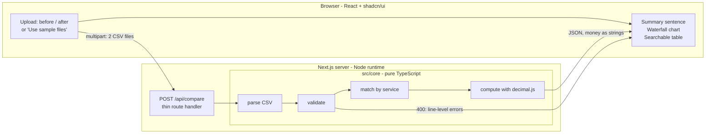

# "Why did my bill change?" explorer: Design

Date: 2026-10-31
Status: Draft, awaiting user review

## 1. Goal

Compare two monthly expense or cloud-cost CSV exports and explain the difference with a waterfall chart and a searchable table. The breakdown must reconcile exactly to the total change.

Demo: upload the two sample files, inspect the largest increase, and click through to the rows behind it.

The project is an interview work submission. It is judged on how well AI was directed and how the result was verified, so verification is a first-class part of the design. Budget: about 2 days at 4-6 hours per day.

## 2. Decisions

| Topic | Decision |
|---|---|
| Stack | Next.js (App Router) + React + TypeScript, Node runtime |
| UI | Tailwind + shadcn/ui + a charting library (Recharts) |
| Arithmetic | decimal.js, no floating point for money |
| Price/quantity split | Sequential: usage at old price, then price change at new quantity |
| Duplicate services in a file | Rejected with line numbers |
| Delivery | Single Docker image, one `docker run` command |
| State | Stateless: no database, no login |

## 3. Architecture

One Next.js app. All parsing, validation, matching and arithmetic live in `src/core/`, which is plain TypeScript with no Next.js or React imports. The API route is a thin adapter. The browser never calculates money; it only renders what the server returns.



### Units

| Unit | Purpose | Depends on |
|---|---|---|
| `src/core/parse` | CSV text to raw rows with line numbers | CSV parser library |
| `src/core/validate` | Raw rows to typed rows, or a list of errors | decimal.js |
| `src/core/compare` | Match two typed row sets, compute per-row and bucket effects | decimal.js |
| `src/core/summary` | Build the summary sentence from totals and buckets | none |
| `src/app/api/compare/route.ts` | HTTP adapter: read multipart, call core, map errors to 400 | core |
| `src/components/*` | Upload, headline, waterfall, table | API JSON only |

## 4. Input format

UTF-8 CSV with the header row `service,quantity,unit_price`.

- Header names are trimmed and case-insensitive. Extra columns are ignored.
- `service`: non-empty after trimming. Matching between files is exact on the trimmed value (case-sensitive).
- `quantity`, `unit_price`: plain non-negative decimals such as `120` or `0.0000166667`. No currency symbols, thousands separators or exponent notation.
- Each service appears at most once per file. A repeat is an error.
- Limits per file: 1 MB, 10,000 rows. A file with a header only (no rows) is valid and means zero cost.

Validation collects all errors rather than stopping at the first. Each error has: file (`before` or `after`), line number, column, and message. The API returns them with status 400 as `{ errors: [...] }`. The repo includes a deliberately broken sample file to demonstrate this.

## 5. Calculation

Money uses decimal.js. Rounding happens only in the UI display; JSON carries exact values as strings.

For each service, cost = quantity x unit_price. Let the before values be (q0, p0) and the after values be (q1, p1).

| Status | Condition | Total change | Usage effect | Price effect |
|---|---|---|---|---|
| added | only in after | q1 x p1 | 0 (the whole change counts in the `added` bucket) | 0 |
| removed | only in before | -(q0 x p0) | 0 | 0 |
| changed | in both, (q0, p0) differs from (q1, p1) | q1 x p1 - q0 x p0 | (q1 - q0) x p0 | (p1 - p0) x q1 |
| unchanged | in both, same values | 0 | 0 | 0 |

For changed services, usage effect + price effect = q1 x p1 - q0 x p0 exactly. Proof: (q1 - q0)p0 + (p1 - p0)q1 = q1p0 - q0p0 + p1q1 - p0q1 = p1q1 - q0p0.

A service with the same cost but different (q, p), for example 10 x 2 becoming 5 x 4, is "changed" with a usage effect of -10 and a price effect of +10. Two opposing bars that net to zero is correct and informative.

Waterfall buckets:

- `added` = sum of added-service costs
- `removed` = sum of removed-service costs (negative)
- `usage` = sum of usage effects over changed services
- `price` = sum of price effects over changed services

Invariant: before total + added + usage + price + removed = after total, exactly. The server asserts this and returns a 500 if it is ever violated. That should be impossible, and the tests check it.

Worked example: EC2 goes from 100 x $0.10 to 120 x $0.12. Usage effect = 20 x 0.10 = $2.00. Price effect = 0.02 x 120 = $2.40. Total change = $4.40 = $14.40 - $10.00.

## 6. API

`POST /api/compare`, multipart form with file fields `before` and `after`.

Success (200):

```json
{
  "totals": { "before": "...", "after": "...", "change": "..." },
  "buckets": { "added": "...", "usage": "...", "price": "...", "removed": "..." },
  "summary": "Total increased by $240.00: $180.00 from newly added services, ...",
  "rows": [
    {
      "service": "...",
      "status": "added | removed | changed | unchanged",
      "before": { "quantity": "...", "unitPrice": "...", "cost": "..." },
      "after":  { "quantity": "...", "unitPrice": "...", "cost": "..." },
      "usageEffect": "...", "priceEffect": "...", "change": "..."
    }
  ]
}
```

`before` is null for added rows and `after` is null for removed rows.

Errors: 400 `{ "errors": [{ "file", "line", "column", "message" }] }` for invalid input, including missing files and over-limit files. 500 if the reconciliation assertion fails.

The server writes the summary sentence so that it is tested together with the numbers. The summary mentions only non-zero buckets, and it handles a total that decreased or did not change.

## 7. UI

A single page built from shadcn/ui components.

1. **Upload:** two file pickers (Before, After) and a "Use sample files" button.
2. **Headline:** the summary sentence and three stat cards (before total, after total, change).
3. **Waterfall chart:** before total, then added, usage, price, removed, then after total. Increases are red and decreases are green. Clicking a bucket bar filters the table to the services contributing to that bucket. Clicking again, or a clear control, removes the filter.
4. **Table:** search by service name, filter by status, sortable columns. The default sort is the largest increase first. A row can be expanded to show its worked formula, for example `(120 - 100) x $0.10 = $2.00`.
5. **Errors:** validation errors are listed by file and line.

Display rounds money to 2 decimals. Exact values appear in tooltips and in the expanded row.

## 8. Verification

This is the main evidence of directing the AI. The hand-calculated cases are written before the calculation code.

1. **Golden cases** in `tests/fixtures/<case>/`: `before.csv`, `after.csv`, `expected.json`, with answers calculated by hand. Cases: headline sample ($240 story), only added, only removed, quantity change only, price change only, both changing, unchanged, same cost with different quantity and price, very small unit price (for example `0.0000166667`), zero quantity, empty file.
2. **Property tests** (Vitest + fast-check) over random file pairs:
   - the before total + all buckets always equals the after total exactly
   - for every changed row, usage + price = change
   - shuffling row order does not change the result
   - swapping before and after negates the total change
3. **Validation tests:** one per rule, checking the reported file, line and column.
4. **API test:** call the route handler with the sample files and with a broken file.
5. **Browser test** (one Playwright run): load samples, click the largest bar, check the table is filtered, expand a row.
6. **CI** (GitHub Actions): type check, lint, tests, Docker build.

## 9. Deliverables

- `README.md`: intro, screenshot or GIF, `docker run` command, CSV format, formula with the worked example, architecture diagram.
- `docs/AI_WORKFLOW.md`: tools used, key steps, time log, and a list of AI mistakes with the test that caught each. The time log starts with the first session.
- `samples/`: a sample pair that tells the $240 story, plus one invalid file.
- A Dockerfile producing one image that serves the app.

## 10. Out of scope

Multiple currencies, real AWS or GCP export formats, fuzzy service-name matching, persistence or accounts, comparing more than two months.

## 11. Schedule

- **Day 1:** project setup, hand-calculated fixtures, core calculation test-first, property tests, validation, API route.
- **Day 2:** UI and click-to-filter, Docker, Playwright test, CI, docs, demo GIF.

## 12. Risks

- A reviewer may ask "where is the backend?" Mitigation: `src/core` and the API route are clearly separate, and the README diagram shows it.
- AI-generated code may use floating point for money. Mitigation: property tests with tiny unit prices, plus a lint or grep check for `parseFloat`/`Number(` in `src/core`.
- Scope creep on UI polish. Mitigation: the table and waterfall are the only required views; everything else is optional.
